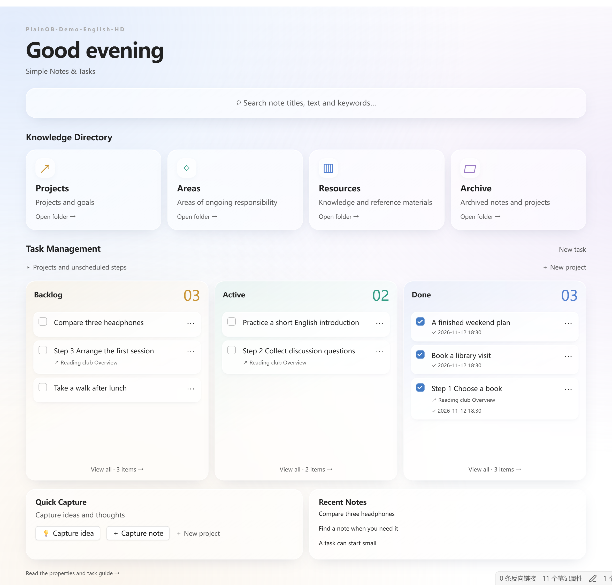
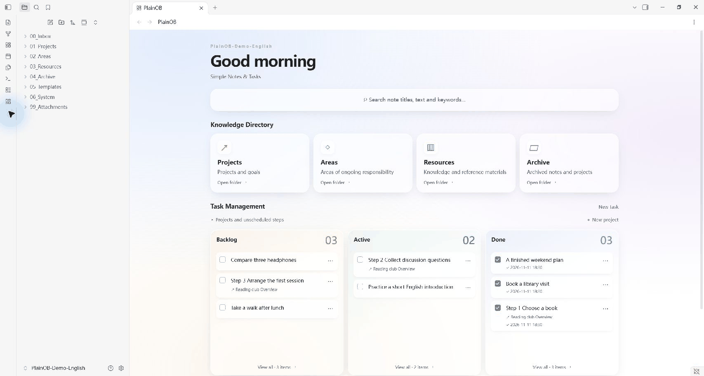
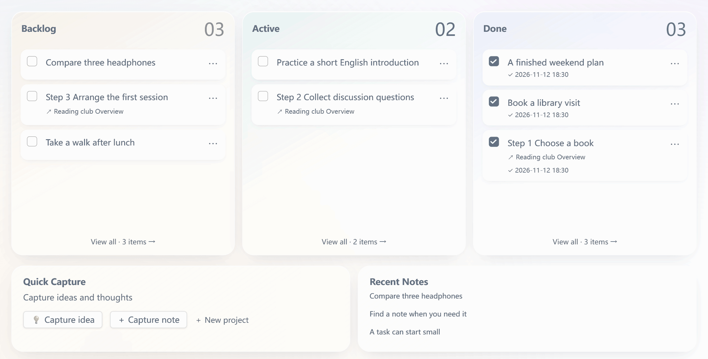
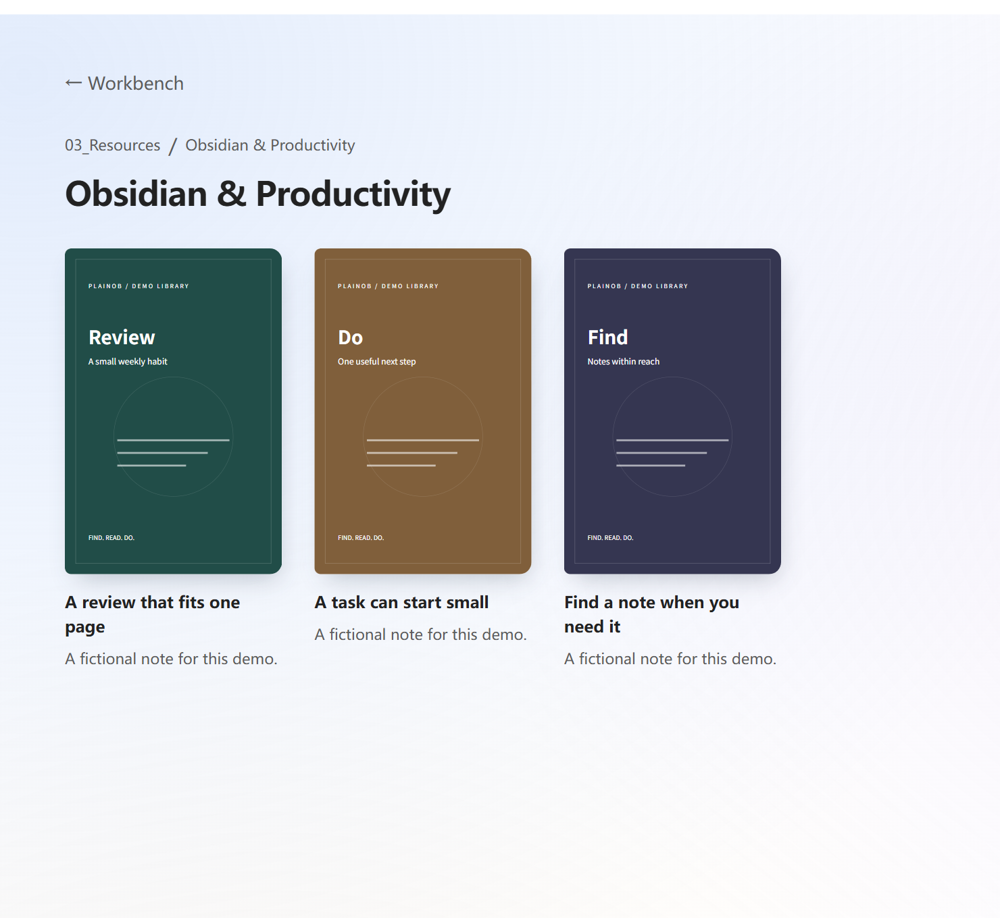
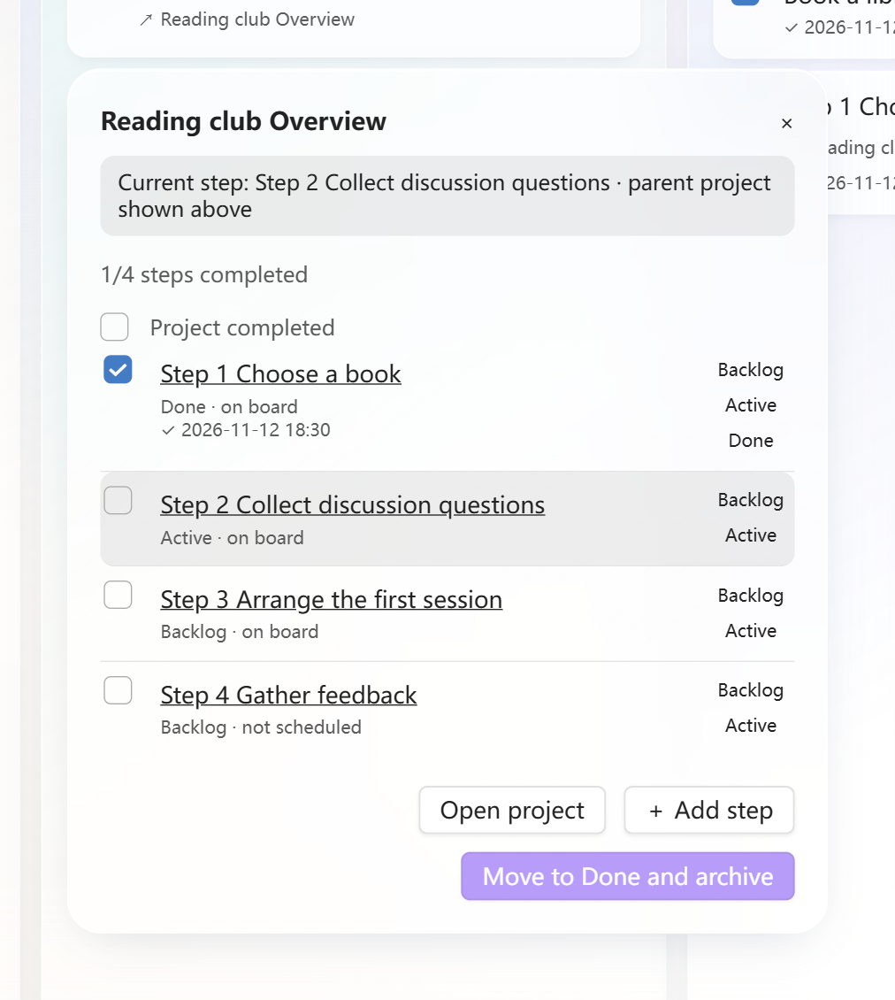

[English](README.md) / [简体中文](README.zh-CN.md) / [繁體中文](README.zh-TW.md) / [日本語](README.ja.md) / [한국어](README.ko.md)

<h1 align="center">PlainOB</h1>

<p align="center">
  <strong>Simple Notes &amp; Tasks</strong><br>
  日々のノート、アイデア、タスクのための、シンプルな Obsidian ホーム。
</p>

<p align="center">
  
  
  <a href="LICENSE"></a>
</p>

<p align="center">
  <a href="https://github.com/GavinYanCQ/obsidian-plainob-dashboard/releases/download/1.4.2/PlainOB-1.4.2-installer.zip"><strong>⬇ インストーラーをダウンロード · 1.4.2</strong></a>
  &nbsp;·&nbsp;
  <a href="CHANGELOG.md">変更履歴を見る</a>
</p>

<p align="center">
  <a href="#-はじめに">はじめに</a> ·
  <a href="#-機能">機能</a> ·
  <a href="docs/INSTALL.en.md">インストールガイド（英語）</a> ·
  <a href="#-開発を支援する">開発を支援する</a>
</p>

道具を整えることに夢中になって、何のために使い始めたのかを忘れてしまう。そんなことが、時々あります。

Obsidian を開いたとき、最初に目に入るのが壁紙、カレンダー、時計、ポモドーロタイマーで埋まった画面であってほしくはありません。パソコンにはすでにそうした機能があり、ホームに並べると気が散ってしまいます。**PlainOB** を作った理由はシンプルです。ホームを、次の三つに集中できる場所にしたかったのです。

1. **見つける**：キーワードでノートのタイトルと本文を検索する。
2. **整理する**：四つの知識ディレクトリから、各カテゴリのノートへすぐに移動する。
3. **進める**：学習、暮らし、仕事のための最小限のタスクボード。単独のタスクも、プロジェクトを順番に進めるためのステップも、「未着手」「進行中」「完了」を見渡せるようにする。

[](docs/images/home-en.png)

## 🚀 はじめに

1. **インストール：**インストール用 ZIP を展開し、`plainob` フォルダを保管庫の `.obsidian/plugins/` に配置して、Obsidian で PlainOB を有効にします。
2. **初期設定：**新しい構成を作るか、既存のフォルダに対応付けるかを選びます。表示言語を選択し、変更内容をプレビューしてから適用します。
3. **使い始める：**アイデアを記録したり、ノートを作成したり、ノートの task プロパティをオンにしてタスクにします。カードを Backlog（未着手）、Active（進行中）、Done（完了）の間で移動できます。

**Windows または macOS のデスクトップ版 Obsidian 1.15.0 以降**が必要です。現在は **1.4.2**で、手動インストールに対応しています。コミュニティプラグイン一覧にはまだ掲載されていません。

→ [インストール、更新、別の端末への導入ガイド（英語）](docs/INSTALL.en.md)

## ✨ 機能

1. **必要なノートを見つける。**タイトルと本文をキーワード検索し、一致する語句が強調表示された文を確認して、元の箇所に移動できます。
2. **知識をたどる。**Projects（プロジェクト）、Areas（継続して取り組む領域）、Resources（資料）、Archive（アーカイブ）の四つの入口から、フォルダとノートを開けます。本棚にはカスタム表紙を表示できます。
3. **取り組むことを把握する。**学習、暮らし、仕事の単独タスクや、プロジェクト内の各ステップを個別に Backlog、Active、Done に配置できます。ドラッグでの並べ替え、完了日時、プロジェクトの進捗、アーカイブからの復元にも対応します。

四段階のセットアップウィザードでは、簡体字中国語または英語のインターフェース、番号付きフォルダ、既存フォルダとの対応付けを選べます。テンプレート、プロパティの選択メニュー、AI による整理ルールは任意の補助機能です。中心にあるのは、いつも上の三つです。

プロジェクト紹介ページは英語、簡体字中国語、繁体字中国語、日本語、韓国語で読めます。**プラグインのインターフェースは、現在、簡体字中国語と英語に対応しています。**ドキュメントの言語を切り替えても、プラグインの表示言語は変わりません。詳細な導入ガイドは[英語](docs/INSTALL.en.md)と[簡体字中国語](docs/INSTALL.zh-CN.md)で提供しています。

## 👀 実際の操作

画像や GIF をクリックすると元の解像度で表示できます。新しい素材は、アプリから直接出力した可逆圧縮 PNG と、操作部分を拡大した高解像度フレームを使用しています。

以下は、実際の Obsidian デスクトップアプリに作成した架空のデモ保管庫です。PlainOB の画面とデモノートは英語です。Obsidian 自体の操作部分はアプリ本体の言語設定に従います。アニメーションは操作の要所のスクリーンショットをつないだもので、連続した画面録画ではありません。

**本文を検索し、一致する文へ移動：**

[](docs/images/search-demo-en.gif)

**カードメニューでタスクを Active に移し、完了にチェックして Done に配置：**

[](docs/images/task-demo-en.gif)

<details>
<summary>本棚の表紙と、個別に管理できるプロジェクトのステップを見る</summary>

[](docs/images/bookshelf-en.png)

[](docs/images/project-steps-en.png)

</details>

## 🧭 日々の使い方

| やりたいこと | PlainOB での操作 |
| --- | --- |
| 思いつきをすぐ残す | アイデアを記録し、Inbox/Ideas に保存 |
| ノートの置き場所を整理する | Inbox 内のノートにカテゴリを設定 |
| ノートをタスクにする | task プロパティをオンにする |
| プロジェクトを段階的に進める | 各ステップのカードを個別に配置・移動 |
| ノートの一文を探し直す | キーワードを検索し、一致する文から原文へ移動 |
| 別の端末でも使う | 内容を別途転送し、自分の設定プロファイルをインポート |

## 動作環境とインストール

**1.4.2**は **Windows・macOS のデスクトップ版 Obsidian 1.15.0 以降**が対象です。モバイル端末には対応していません。両 OS で同じプラグインファイルを使用でき、特定の端末に固定されたパスは含まれていません。

現在は手動インストールに対応しており、Obsidian のコミュニティプラグイン一覧にはまだ申請していません。[インストールと更新の説明（英語）](docs/INSTALL.en.md)をご覧ください。

配布物にはプラグインのコードとドキュメントが含まれます。個人の保管庫、保存済み設定、認証情報、ノート、同期設定は含まれません。有効にするとセットアップが開き、内容を確認して適用した後にのみ、フォルダと選択した初期ファイルが作成されます。ホームに表示する名前は、初期状態では空欄です。

## 既存の保管庫と別の端末

Inbox や Projects などの役割を、既存の `Drafts` や `Work` といったフォルダに対応付けられます。セットアップは既存のノートやテンプレートを保持し、古いノートを一括で移動・書き換えしません。その後のタスク自動処理は task をオンにしたノート、分類の自動処理はカテゴリを選んだ Inbox 内のノートが対象です。

別の端末では、任意の方法で保管庫の内容を同期またはコピーし、PlainOB をインストールした後、自分の元の環境から書き出した設定プロファイルをインポートします。プロファイルには自分で選んだフォルダ名、表示名、ルールが含まれるため、他人と共有する前に確認してください。プロファイルはノートを転送せず、ほかのプラグインもインストールしません。同期サービスは任意で、PlainOB とは別のものです。

## 任意の連携とプライバシー

基本機能に Metadata Menu、Claudian、BRAT、同期プラグインは必要ありません。Metadata Menu はプロパティの選択メニューを提供しますが、セットアップによる自動設定は現在 0.8.12 のみ対応しています。AI ツールとアカウントは別途設定します。PlainOB がこれらをダウンロード・インストール・有効化することはありません。

PlainOB 自体はネットワーク通信を行わず、利用状況の解析も含みません。任意の AI 整理ルールで公式の動画埋め込みが生成される場合、そのノートを開くと動画サービスに接続します。外部の AI・同期プラグインは、それぞれの設定とポリシーに従います。[プライバシーと依存関係（英語・簡体字中国語）](docs/PRIVACY.md)をご覧ください。

## 開発と検証

Python 3 と Node.js 22 LTS 以降が必要です。追加パッケージのインストールは不要です。

```sh
python work/build_workbench.py
node --test work/workbench/*.test.js
python work/package_public.py
```

ビルド済みの main.js をインストールしてください。ローカルの自動チェック 79 件に合格しています。ユーザーから、Windows 版 1.4.2 の検索、タスク移動、完了後の復元、プロジェクトのアーカイブが正常で、Mac でも 1.4.0 から更新後に正常に使えたとの報告がありました。新版の新規導入に関する全項目の確認を意味するものではありません。確認範囲と未完了のコミュニティ審査は[リリースチェックリスト](docs/RELEASE-CHECKLIST.md)をご覧ください。

## 💖 開発を支援する

PlainOB が日々の記録に役立っていたら、以下のいずれかの方法で継続的な開発をご支援いただけるとうれしいです。このオープンソースプロジェクトへの応援、ありがとうございます。

<table>
  <thead>
    <tr>
      <th align="center">Ko-fi <em>中国本土以外の地域</em></th>
      <th></th>
      <th align="center">WeChat Pay <em>中国本土</em></th>
    </tr>
  </thead>
  <tbody>
    <tr>
      <td align="center" valign="middle"><a href="https://ko-fi.com/gavinyancq"></a></td>
      <td align="center" valign="middle">または</td>
      <td align="center" valign="middle"><a href="docs/images/wechat-pay.png"></a><br><sub>WeChat で読み取り · クリックで原寸画像を表示</sub></td>
    </tr>
  </tbody>
</table>

リポジトリへの Star、問題の報告、翻訳やドキュメントの改善も、大きな助けになります。[貢献ガイド（英語）](CONTRIBUTING.md)をご覧ください。

## ライセンス

MIT · Copyright (c) 2026 GavinCQ。[LICENSE](LICENSE)をご覧ください。
