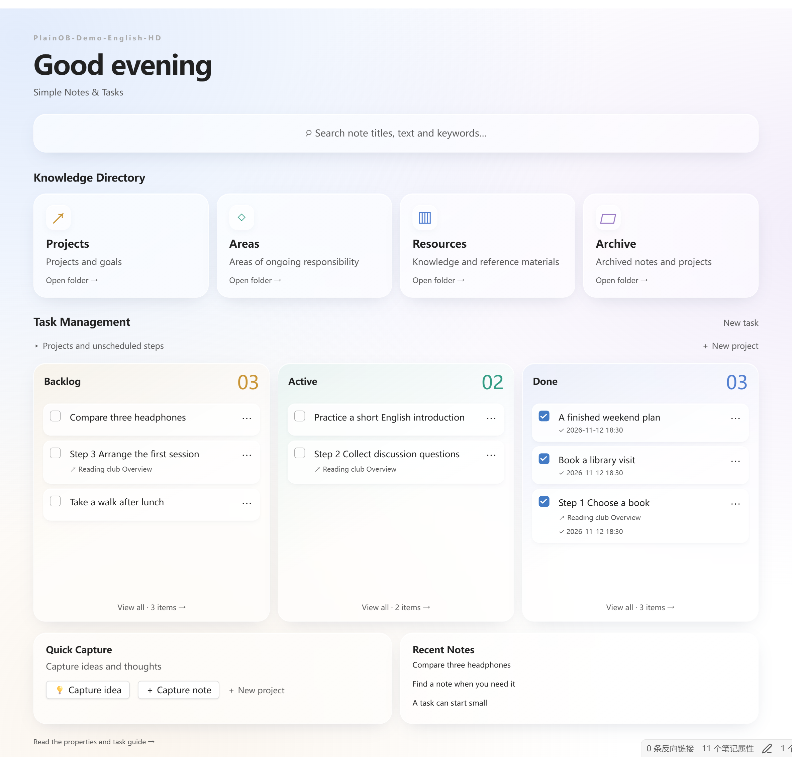
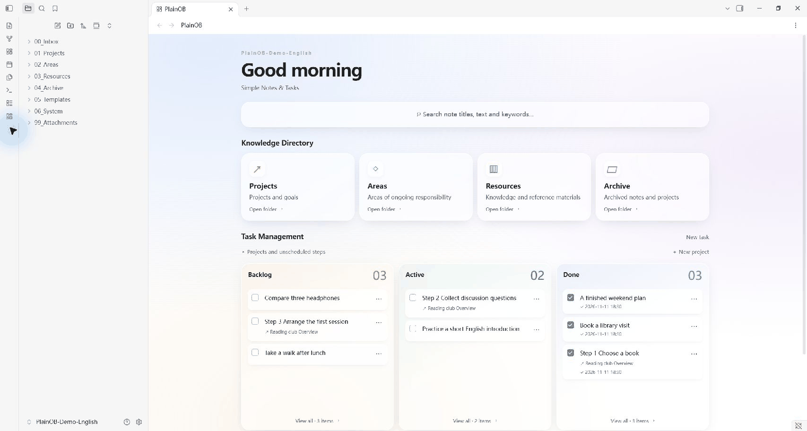
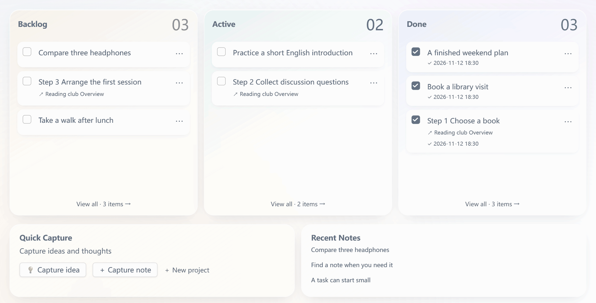
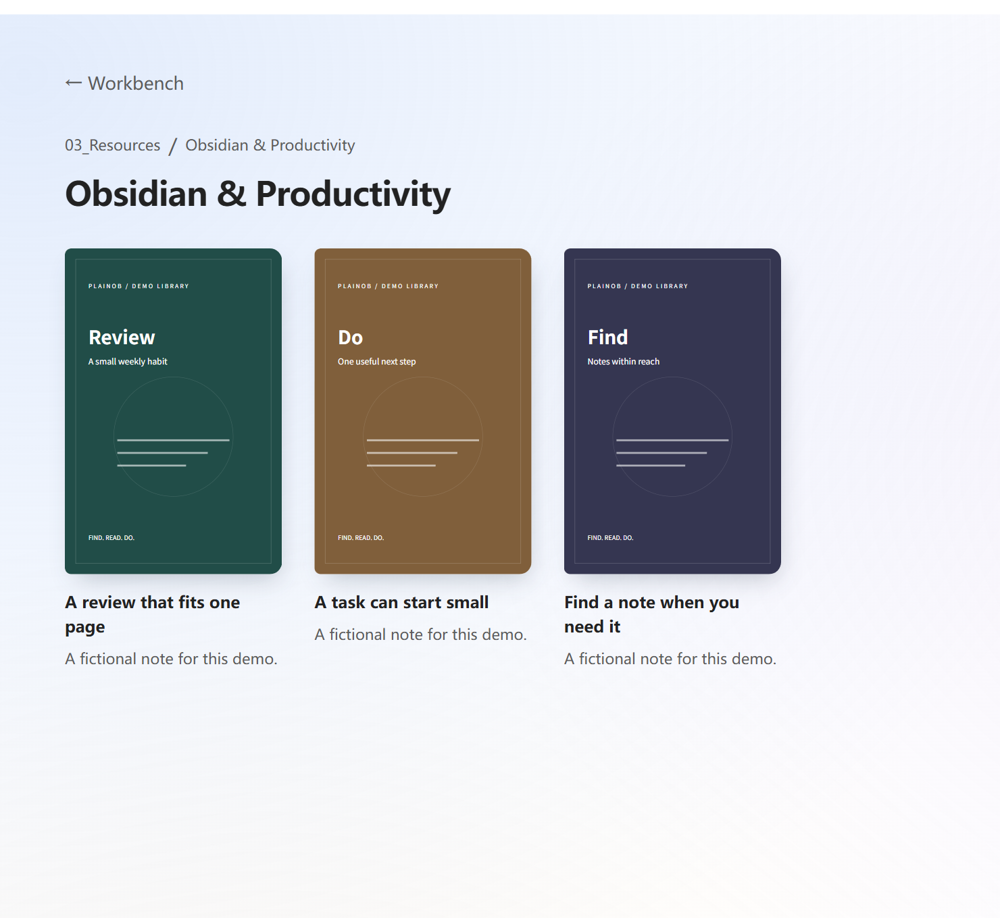
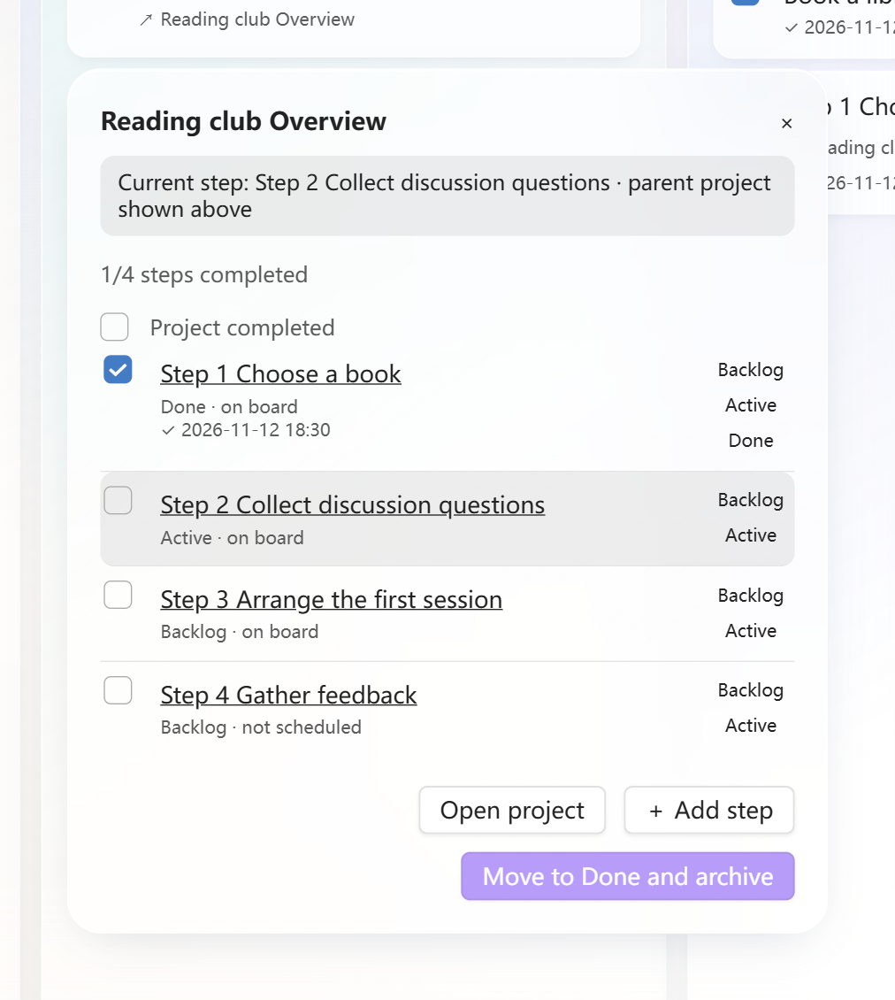

[English](README.md) / [简体中文](README.zh-CN.md) / [繁體中文](README.zh-TW.md) / [日本語](README.ja.md) / [한국어](README.ko.md)

<h1 align="center">PlainOB</h1>

<p align="center">
  <strong>Simple Notes &amp; Tasks</strong><br>
  일상의 노트, 아이디어, 할 일을 위한 간단한 Obsidian 홈 화면.
</p>

<p align="center">
  
  
  <a href="LICENSE"></a>
</p>

<p align="center">
  <a href="https://github.com/GavinYanCQ/obsidian-plainob-dashboard/releases/download/1.4.2/PlainOB-1.4.2-installer.zip"><strong>⬇ 설치 파일 다운로드 · 1.4.2</strong></a>
  &nbsp;·&nbsp;
  <a href="CHANGELOG.md">변경 기록 보기</a>
</p>

<p align="center">
  <a href="#-빠른-시작">빠른 시작</a> ·
  <a href="#-기능">기능</a> ·
  <a href="docs/INSTALL.en.md">설치 안내(영어)</a> ·
  <a href="#-후원과-지원">후원과 지원</a>
</p>

도구를 꾸미고 설정하는 데 몰두하다 보면, 정작 그 도구를 쓰기 시작한 이유를 잊곤 합니다.

Obsidian을 열었을 때 배경화면, 달력, 시계, 뽀모도로 타이머로 가득한 화면부터 마주하고 싶지는 않았습니다. 컴퓨터에 이미 있는 기능을 홈 화면에 늘어놓으면 집중하기가 더 어려워집니다. **PlainOB**를 만든 이유는 간단합니다. 홈 화면이 제 역할을 하도록, 세 가지 핵심 요구에만 집중하고 싶었습니다.

1. **찾기**: 키워드로 노트 제목과 본문을 바로 검색합니다.
2. **정리하기**: 네 가지 지식 디렉터리를 통해 각 분류의 노트로 빠르게 이동합니다.
3. **진행하기**: 학습, 생활, 업무를 위한 간결한 작업 보드입니다. 독립적인 할 일도, 프로젝트를 순서대로 진행하기 위한 단계별 작업도 관리하며, 무엇이 대기 중이고 진행 중이며 완료됐는지 한눈에 확인합니다.

[](docs/images/home-en.png)

## 🚀 빠른 시작

1. **설치:** 설치용 ZIP의 압축을 풀고 `plainob` 폴더를 보관함의 `.obsidian/plugins/`에 넣은 다음, Obsidian에서 PlainOB를 활성화합니다.
2. **초기 설정:** 새 구성을 만들거나 기존 폴더에 연결합니다. 인터페이스 언어를 선택하고, 변경 내용을 미리 확인한 뒤 적용합니다.
3. **사용 시작:** 아이디어를 기록하거나 노트를 만들고, 노트의 task 속성을 켜서 할 일로 관리합니다. 카드를 Backlog(대기), Active(진행 중), Done(완료) 사이에서 이동할 수 있습니다.

**Windows 또는 macOS 데스크톱용 Obsidian 1.15.0 이상**이 필요합니다. 현재 버전은 **1.4.2**으로, 수동 설치를 지원합니다. 커뮤니티 플러그인 목록에는 아직 등록되지 않았습니다.

→ [설치, 업데이트, 두 번째 기기 설정 안내(영어)](docs/INSTALL.en.md)

## ✨ 기능

1. **필요한 노트 찾기.** 제목과 본문을 키워드로 검색하고, 일치하는 단어가 강조된 문장을 확인한 뒤 원문 위치로 이동합니다.
2. **지식 살펴보기.** Projects(프로젝트), Areas(지속적으로 관리할 영역), Resources(자료), Archive(보관)의 네 가지 진입점에서 폴더와 노트를 탐색합니다. 책장에는 사용자 지정 표지도 표시할 수 있습니다.
3. **할 일 파악하기.** 학습, 생활, 업무의 개별 작업과 프로젝트의 각 단계를 Backlog, Active, Done에 독립적으로 배치합니다. 드래그 정렬, 완료 시각, 프로젝트 진행률, 보관 후 복원을 지원합니다.

네 단계의 설치 마법사에서 중국어 간체 또는 영어 인터페이스, 번호가 붙은 폴더 구성, 기존 폴더 연결을 선택할 수 있습니다. 템플릿, 속성 선택 메뉴, AI 정리 규칙은 선택 사항입니다. 작업 공간의 중심은 언제나 위의 세 가지입니다.

프로젝트 소개 페이지는 영어, 중국어 간체, 중국어 번체, 일본어, 한국어로 제공됩니다. **플러그인 인터페이스는 현재 중국어 간체와 영어를 지원합니다.** 문서 언어를 바꿔도 플러그인 인터페이스 언어는 바뀌지 않습니다. 자세한 설치 안내는 [영어](docs/INSTALL.en.md)와 [중국어 간체](docs/INSTALL.zh-CN.md)로 제공됩니다.

## 👀 실제 사용 모습

이미지나 GIF를 클릭하면 원본 해상도로 볼 수 있습니다. 새 자료는 앱에서 직접 내보낸 무손실 PNG와 조작 영역에 초점을 맞춘 고해상도 프레임을 사용합니다.

아래 화면은 실제 Obsidian 데스크톱 앱에 만든 가상의 데모 보관함입니다. PlainOB 인터페이스와 데모 노트는 영어로 표시됩니다. Obsidian 자체의 조작 요소는 앱의 언어 설정을 따릅니다. 애니메이션은 주요 조작 화면을 이어 붙인 것으로, 연속 화면 녹화가 아닙니다.

**본문을 검색하고 일치하는 문장으로 이동:**

[](docs/images/search-demo-en.gif)

**카드 메뉴로 작업을 Active로 옮기고, 완료를 체크한 뒤 Done에 배치:**

[](docs/images/task-demo-en.gif)

<details>
<summary>책장 표지와 개별 프로젝트 단계 보기</summary>

[](docs/images/bookshelf-en.png)

[](docs/images/project-steps-en.png)

</details>

## 🧭 일상에서 사용하기

| 하고 싶은 일 | PlainOB에서 하는 방법 |
| --- | --- |
| 떠오른 생각을 바로 남기기 | 아이디어를 빠르게 기록해 Inbox/Ideas에 저장 |
| 노트 위치 정리하기 | Inbox 안의 노트에 분류 지정 |
| 노트를 할 일로 만들기 | task 속성 켜기 |
| 프로젝트를 단계별로 진행하기 | 각 단계의 카드를 개별적으로 배치하고 이동 |
| 노트의 한 문장 다시 찾기 | 키워드를 검색하고 일치하는 문장을 눌러 원문으로 이동 |
| 다른 기기에서 사용하기 | 내용을 별도로 전송한 뒤 자신의 설정 프로필 가져오기 |

## 호환성과 설치

**1.4.2**은 **Windows 및 macOS 데스크톱용 Obsidian 1.15.0 이상**을 대상으로 합니다. 모바일 기기는 지원하지 않습니다. 두 운영체제에서 같은 플러그인 파일을 사용하며, 특정 컴퓨터에 고정된 경로는 포함하지 않습니다.

현재 수동 설치를 지원하며, Obsidian 커뮤니티 플러그인 목록에는 아직 제출하지 않았습니다. [설치와 업데이트 안내(영어)](docs/INSTALL.en.md)를 참고하세요.

다운로드 파일에는 플러그인 코드와 문서가 들어 있습니다. 개인 보관함, 저장된 설정, 인증 정보, 노트, 동기화 설정은 포함하지 않습니다. 처음 활성화하면 설정 마법사가 열리며, 계획을 확인하고 적용한 뒤에만 폴더와 선택한 초기 파일이 만들어집니다. 홈 화면에 표시할 이름은 처음에는 비어 있습니다.

## 기존 보관함과 다른 기기

Inbox나 Projects 같은 역할을 기존의 `Drafts`, `Work` 폴더 등에 연결할 수 있습니다. 설정 과정은 기존 노트와 템플릿을 유지하며, 이전 노트를 일괄 이동하거나 다시 쓰지 않습니다. 이후 작업 자동화는 task를 켠 노트에, 분류 자동화는 분류를 선택한 Inbox 노트에 적용됩니다.

다른 기기에서는 원하는 방법으로 보관함 내용을 동기화하거나 복사하고, PlainOB를 설치한 뒤 원래 기기에서 내보낸 자신의 설정 프로필을 가져오면 됩니다. 프로필에는 사용자가 선택한 폴더 이름, 표시 이름, 규칙이 들어 있으므로 다른 사람과 공유하기 전에 확인하세요. 프로필은 노트를 전송하거나 다른 플러그인을 설치하지 않습니다. 동기화 서비스는 선택 사항이며 PlainOB와 별개입니다.

## 선택적 연동과 개인정보

핵심 기능에 Metadata Menu, Claudian, BRAT 또는 동기화 플러그인은 필요하지 않습니다. Metadata Menu는 속성 선택 메뉴를 제공하며, 설정 마법사의 자동 구성은 현재 0.8.12 버전만 지원합니다. AI 도구와 계정은 따로 설정해야 합니다. PlainOB는 이런 플러그인을 다운로드하거나 설치하거나 활성화하지 않습니다.

PlainOB 자체는 네트워크 요청을 보내지 않으며 사용 분석 기능을 포함하지 않습니다. 선택적 AI 규칙이 공식 동영상 임베드를 만들 수 있으며, 해당 노트를 열면 동영상 플랫폼에 연결됩니다. 외부 AI 및 동기화 플러그인은 각자의 설정과 정책을 따릅니다. [개인정보와 의존 도구 안내(영어·중국어 간체)](docs/PRIVACY.md)를 참고하세요.

## 개발과 검증

Python 3와 Node.js 22 LTS 이상이 필요합니다. 추가 패키지를 설치할 필요는 없습니다.

```sh
python work/build_workbench.py
node --test work/workbench/*.test.js
python work/package_public.py
```

빌드된 main.js를 설치하세요. 로컬 자동 검사 79개를 통과했습니다. 사용자는 Windows의 1.4.2 검색, 작업 이동, 완료 후 복원, 프로젝트 보관 테스트가 정상이며 Mac에서도 1.4.0에서 업그레이드한 후 정상적으로 사용할 수 있다고 보고했습니다. 새 버전의 모든 신규 설치 상황을 개별 검증했다는 뜻은 아닙니다. 검증 범위와 남은 커뮤니티 심사는 [릴리스 점검표](docs/RELEASE-CHECKLIST.md)를 참고하세요.

## 💖 후원과 지원

PlainOB가 일상의 기록에 도움이 된다면 아래 방법 중 하나로 지속적인 개발을 후원해 주세요. 이 오픈 소스 프로젝트를 응원해 주셔서 감사합니다.

<table>
  <thead>
    <tr>
      <th align="center">Ko-fi <em>중국 본토 외 지역</em></th>
      <th></th>
      <th align="center">WeChat Pay <em>중국 본토</em></th>
    </tr>
  </thead>
  <tbody>
    <tr>
      <td align="center" valign="middle"><a href="https://ko-fi.com/gavinyancq"></a></td>
      <td align="center" valign="middle">또는</td>
      <td align="center" valign="middle"><a href="docs/images/wechat-pay.png"></a><br><sub>WeChat으로 스캔 · 클릭하면 원본 보기</sub></td>
    </tr>
  </tbody>
</table>

저장소에 Star를 남기거나, 문제를 제보하거나, 번역과 문서를 개선하는 것도 큰 도움이 됩니다. [기여 안내(영어)](CONTRIBUTING.md)를 참고하세요.

## 라이선스

MIT · Copyright (c) 2026 GavinCQ. [LICENSE](LICENSE)를 참고하세요.
