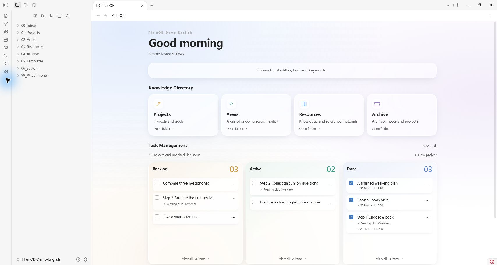
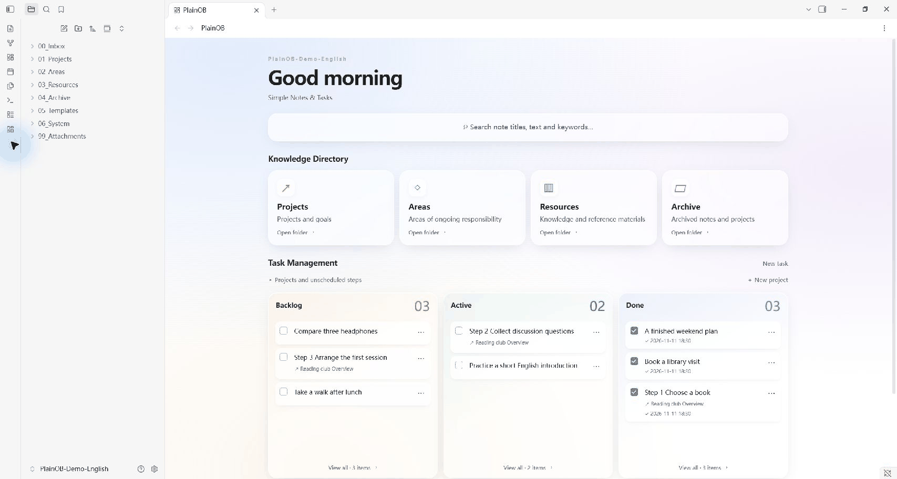
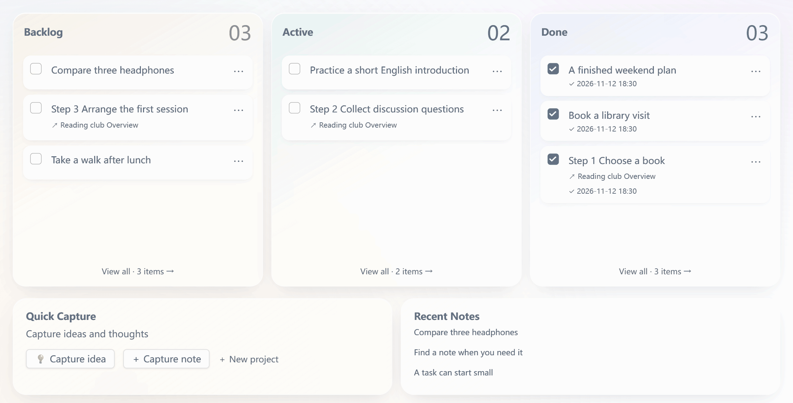
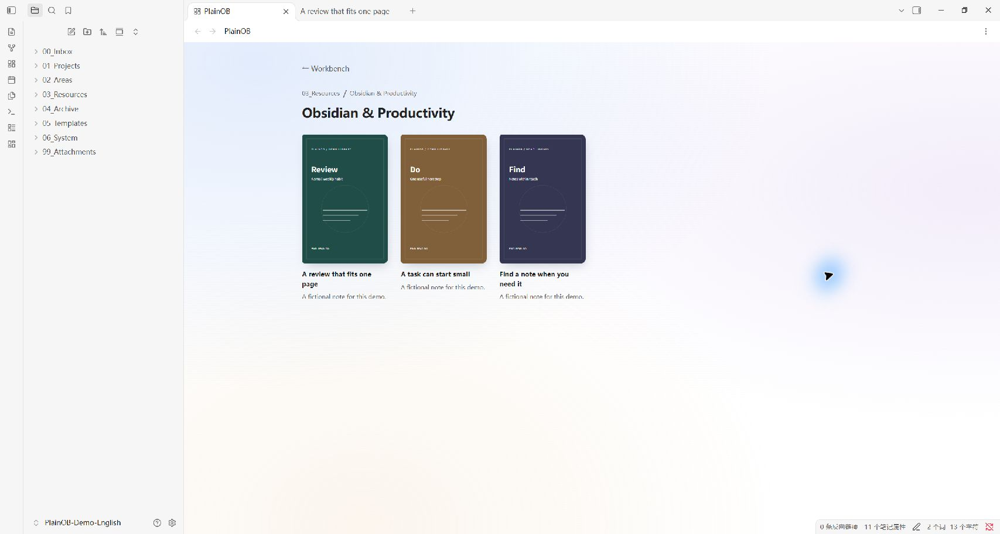
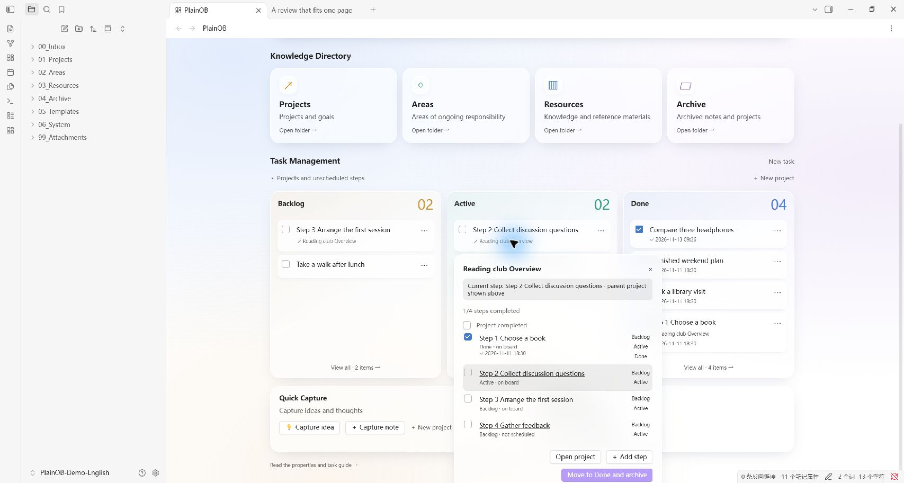

[English](README.md) / [简体中文](README.zh-CN.md) / [繁體中文](README.zh-TW.md) / [日本語](README.ja.md) / [한국어](README.ko.md)

<h1 align="center">PlainOB</h1>

<p align="center">
  <strong>Simple Notes &amp; Tasks</strong><br>
  A simple Obsidian home for your daily notes, ideas and tasks.
</p>

<p align="center">
  
  
  <a href="LICENSE"></a>
</p>

<p align="center">
  <a href="#-quick-start">Quick start</a> ·
  <a href="#-features">Features</a> ·
  <a href="docs/INSTALL.en.md">Installation guide</a> ·
  <a href="#-sponsorship--support">Support</a>
</p>

Sometimes we get so caught up in tinkering with our tools that we forget why we started using them.

When I open Obsidian, I don't want the first thing I see to be a screen full of wallpapers, calendars, clocks and Pomodoro timers. My computer already has those tools; putting them on the home screen just divides my attention. The idea behind **PlainOB** is simple: let the home screen do its job by meeting three core needs:

1. **Find it**: Search note titles and body text directly by keyword.
2. **Keep it organized**: Browse four knowledge directories and click through to the notes in each category.
3. **Move it forward**: A minimal task board for learning, life and work. Manage standalone tasks or break a project into a sequence of steps, and always see what's waiting, in progress or done.



## 🚀 Quick start

1. **Install:** extract the installer and place its `plainob` folder in your vault's `.obsidian/plugins/` directory. Enable PlainOB in Obsidian.
2. **Set up:** choose a new system or connect your existing folders. Choose your interface language, review the planned changes, then apply.
3. **Start using it:** capture an idea, create a note or mark a note as a task. Move task cards between Backlog, Active and Done.

Requires **Obsidian 1.15.0+ on Windows or macOS desktop**. Current version: **1.4.1 preview**, installed manually. Community directory listing is pending.

→ [Full installation, upgrades and a second device](docs/INSTALL.en.md)

## ✨ Features

1. **Find a note.** Search titles and body text by keyword, preview highlighted matching sentences and jump to the original passage.
2. **Browse your knowledge.** Four entry points—Projects, Areas, Resources and Archive—lead to your folders and notes. Bookshelves can show custom covers.
3. **See what needs doing.** Manage everyday work, life and learning tasks, including individual steps you work through in a project. Schedule steps independently in Backlog, Active and Done, with drag sorting, completion dates, project progress and archive recovery.

A four-step wizard helps you get started with Chinese or English interfaces, numbered folders or existing-folder mappings. Templates, property dropdowns and AI rules are optional helpers. The focus stays on those three things.

This project page is available in English, Simplified Chinese, Traditional Chinese, Japanese and Korean. **The plugin interface currently supports Simplified Chinese and English.** Switching the documentation language does not change the plugin interface.

## 👀 See it in use

These captures show a fictional demo vault in the real Obsidian desktop app, with PlainOB's interface and demo notes in English. Obsidian's own controls follow the host app language. Animations combine key action screenshots; they are not continuous screen recordings.

**Search note text and jump to the matching passage:**



**Move a task to Active, check it complete, then place it in Done using the card menu:**



<details>
<summary>Bookshelf covers and independent project steps</summary>





</details>

## 🧭 How it fits together

| What you want to do | In PlainOB |
| --- | --- |
| Save a thought quickly | Capture an idea in Inbox/Ideas |
| Organize a note | Choose a category for an Inbox note |
| Act on a note | Enable its task property |
| Work through a project | Schedule and move individual steps |
| Find a passage again | Search for a keyword and jump to a matching sentence |
| Connect a second device | Transfer your content separately and import your own settings profile |

## Compatibility and installation

Version **1.4.1 preview** targets **Windows and macOS desktop**, with **Obsidian 1.15.0 or later**. Mobile is not supported. The same plugin files run on both desktop systems; no machine-specific paths are included.

Manual installation is currently supported; this plugin has not been submitted to the Obsidian community directory. See [installation and upgrades](docs/INSTALL.en.md).

The download contains plugin code and documentation. It does not contain a personal vault, saved settings, credentials, notes or sync configuration. Enabling the plugin opens setup; folders and optional starter files are created only after you review and apply its plan. Your greeting name starts blank.

## Existing vaults and other devices

Map roles such as Inbox and Projects to existing folders, for example `Drafts` and `Work`. Setup keeps existing notes and templates, without moving or rewriting old notes in bulk. Task automation subsequently acts on notes you mark as tasks and Inbox notes you classify.

For another device, sync or copy the vault contents using your chosen method, install PlainOB, then import a migration profile from your own installation. Profiles contain your chosen folder names, greeting and rules: review them before sharing. They do not transfer notes or install plugins. Sync is optional and is not part of PlainOB.

## Optional integrations and privacy

The core workbench does not require Metadata Menu, Claudian, BRAT or a sync plugin. Metadata Menu provides property dropdowns; the setup adapter currently supports version 0.8.12 only. AI tools and their accounts are configured separately. PlainOB does not download or enable dependencies.

PlainOB makes no network requests and includes no analytics. Optional AI-generated note rules can produce official video embeds; opening those notes contacts the video platform. External AI and sync plugins follow their own settings and policies. See [privacy and dependencies](docs/PRIVACY.md).

## Development

Python 3 and Node.js 22 LTS or later are required. No package installation is needed.

```sh
python work/build_workbench.py
node --test work/workbench/*.test.js
python work/package_public.py
```

Install the generated `main.js`, never the unbundled source entry. See [contributing](CONTRIBUTING.md). All 72 automated checks pass. A user has also reported successful 1.4.1 installation and use in empty Windows and macOS test vaults; the Windows report included Chinese/English setup and Task Management. The [release checklist](docs/RELEASE-CHECKLIST.md) distinguishes automated checks, user reports and additional scenarios that have not been individually confirmed.

## 💖 Sponsorship & Support

If PlainOB makes your day a little easier, you can support its continued development through either option below. Thank you for supporting this open-source project.

<table>
  <thead>
    <tr>
      <th align="center">Ko-fi <em>Non-China Region</em></th>
      <th></th>
      <th align="center">WeChat Pay <em>China Region</em></th>
    </tr>
  </thead>
  <tbody>
    <tr>
      <td align="center" valign="middle"><a href="https://ko-fi.com/gavinyancq"></a></td>
      <td align="center" valign="middle">or</td>
      <td align="center" valign="middle"><a href="docs/images/wechat-pay.png"></a><br><sub>Scan with WeChat · click for full size</sub></td>
    </tr>
  </tbody>
</table>

You can also support the project by starring the repository, reporting bugs or improving translations and documentation. See [contributing](CONTRIBUTING.md).

## License

MIT · Copyright (c) 2026 GavinCQ. See [LICENSE](LICENSE).
