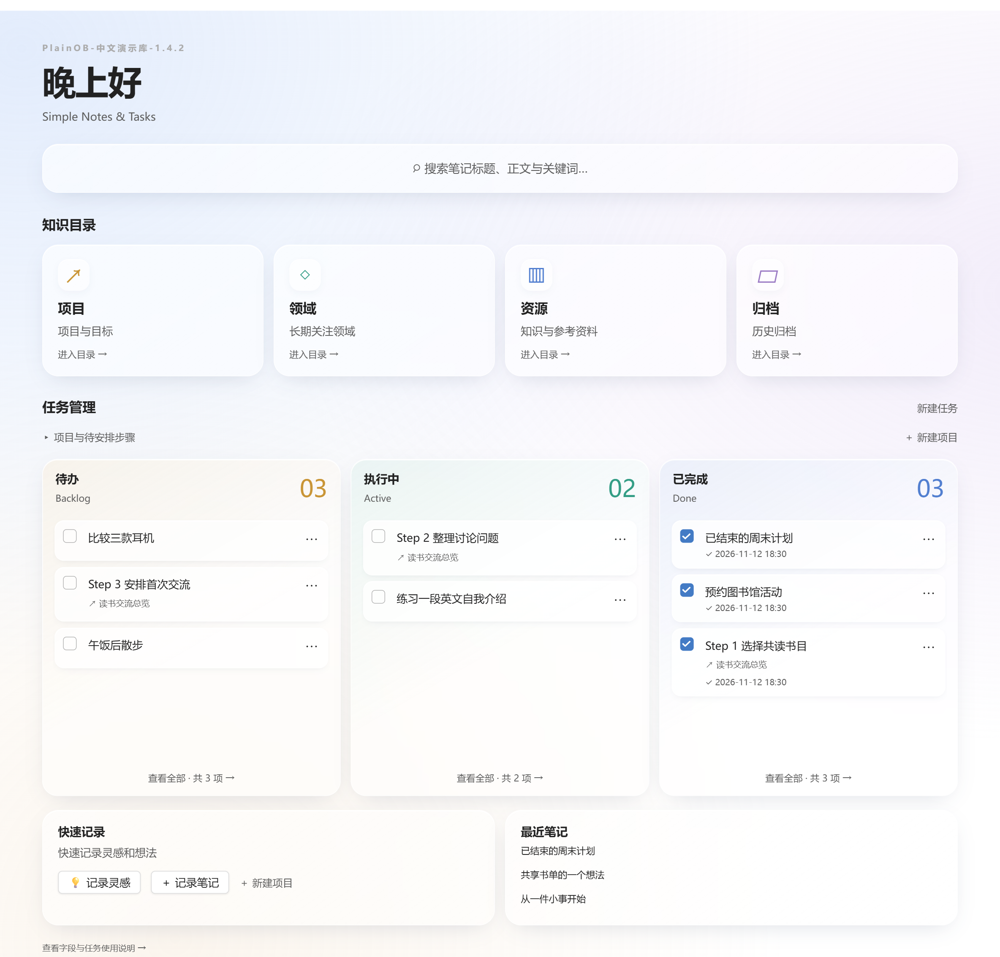
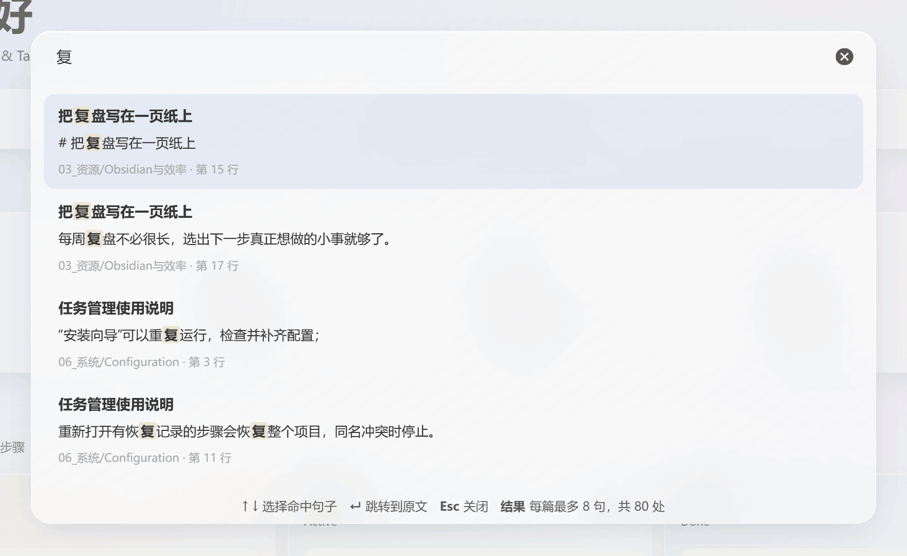
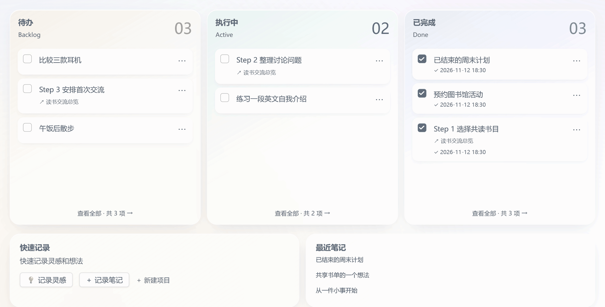
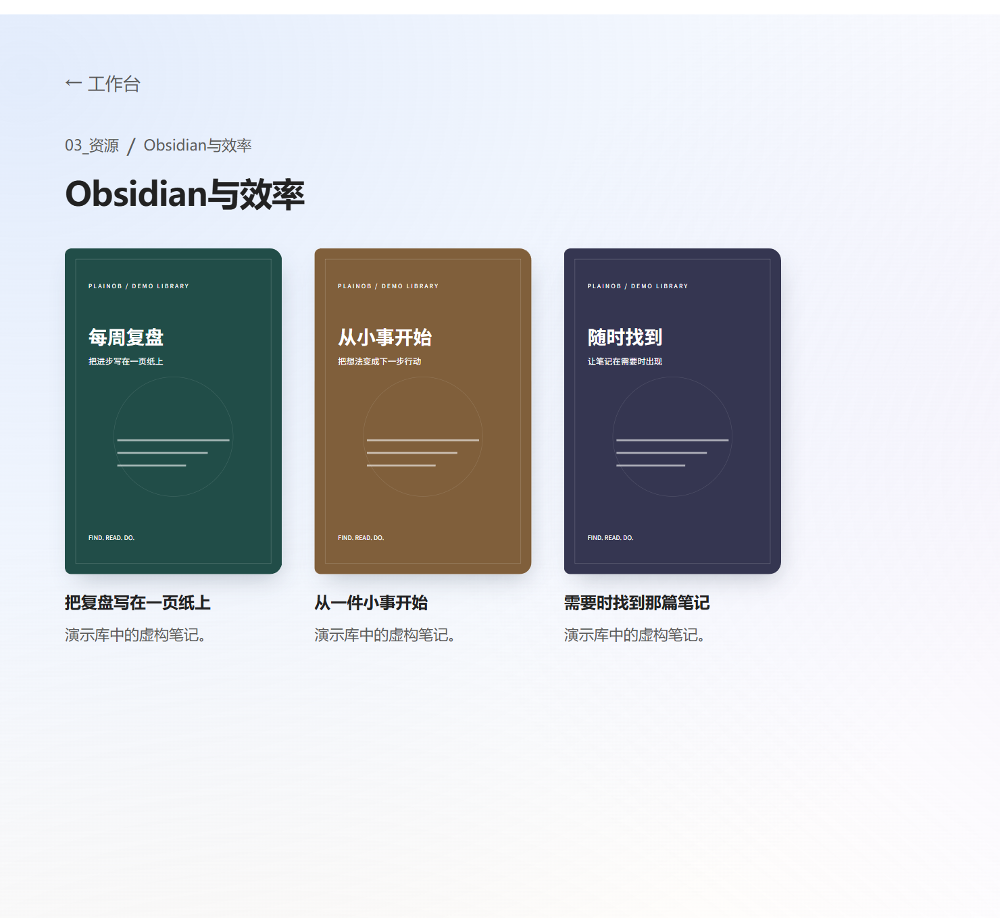
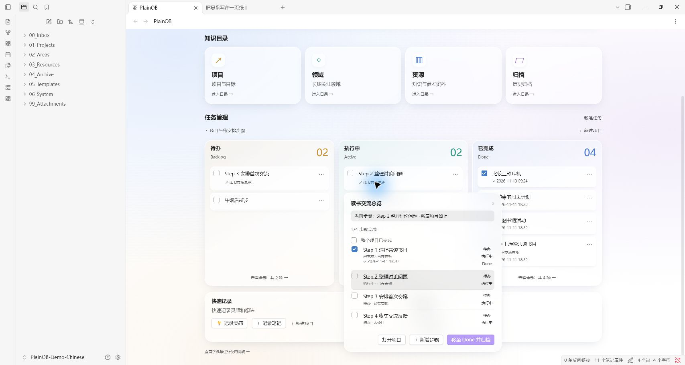

[English](README.md) / [简体中文](README.zh-CN.md) / [繁體中文](README.zh-TW.md) / [日本語](README.ja.md) / [한국어](README.ko.md)

<h1 align="center">PlainOB</h1>

<p align="center">
  <strong>Simple Notes &amp; Tasks</strong><br>
  为日常笔记、灵感和任务，准备一个简单的 Obsidian 首页。
</p>

<p align="center">
  
  
  <a href="LICENSE"></a>
</p>

<p align="center">
  <a href="https://github.com/GavinYanCQ/obsidian-plainob-dashboard/releases/download/1.4.2/PlainOB-1.4.2-installer.zip"><strong>⬇ 下载安装包 · 1.4.2</strong></a>
  &nbsp;·&nbsp;
  <a href="CHANGELOG.md">查看更新记录</a>
</p>

<p align="center">
  <a href="#-快速开始">快速开始</a> ·
  <a href="#-功能">功能介绍</a> ·
  <a href="docs/INSTALL.zh-CN.md">安装指南</a> ·
  <a href="#-赞助与支持">赞助支持</a>
</p>

很多时候，我们过于执着折腾工具的过程，反而忘了使用工具的初衷。

我不想在打开 Obsidian 的第一眼，先面对满屏的壁纸、日历、时钟和番茄钟——这些功能系统里早就有，堆在主页上只会分散注意力。做 **PlainOB** 的想法很简单，让首页回归它该有的样子，只解决三个核心需求：

1. **找得到**：支持通过关键词直接检索笔记标题与正文。
2. **理得清**：内置四类知识目录，点击直达对应子类的笔记。
3. **推得动**：一套极简的任务看板，兼顾学习、生活与工作。支持独立的单条任务，也支持拆解项目下的连续子步骤，随时看清哪些待办、哪些在做、哪些已完成。



## 🚀 快速开始

1. **安装插件：**解压安装包，把 `plainob` 文件夹放入 Vault 的 `.obsidian/plugins/`，在 Obsidian 中启用。
2. **完成向导：**选择新建系统或对应已有目录，选择界面语言，预览后执行。
3. **开始记录：**记录一条灵感、新建笔记，或勾选笔记的 task 属性，将任务卡片在待办、执行中和已完成之间流转。

适用于 **Windows 和 macOS 桌面端，Obsidian 1.15.0+**。当前为 **1.4.2**，采用手动安装，尚未上架社区插件市场。

→ [完整安装、升级与双端接入指南](docs/INSTALL.zh-CN.md)

## ✨ 功能

1. **搜到需要的笔记。**关键词搜索标题和正文，预览高亮的匹配句，点击回到原文位置。
2. **快速进入知识目录。**项目、领域、资源、归档四个入口，逐层进入分类与笔记；书架可展示自定义封面。
3. **看清手头的任务。**学习、生活和工作中的独立事项，以及项目里按顺序推进的步骤，都能分别安排到待办、执行中、已完成。支持拖动排序、完成时间、项目进度及归档恢复。

四步安装向导帮助你开始使用，可选中英文界面、编号目录或已有目录。模板、属性下拉与 AI 整理规则是可选辅助；工作台的中心始终是上面三件事。

项目首页文档可切换英文、简体中文、繁体中文、日语和韩语。**插件界面目前支持简体中文和英文**；切换文档语言不会改变插件界面语言。

## 👀 看看实际操作

下列画面来自真实 Obsidian 中的虚构演示库。动图按操作关键画面合成，展示结果与步骤，不是连续录屏。

**搜索正文并跳转到匹配句：**



**任务从待办到执行中，再勾选完成并移入已完成：**此段通过卡片菜单操作。



<details>
<summary>查看书架与独立项目步骤</summary>





</details>

## 🧭 日常怎么使用

| 想做什么 | 在 PlainOB 中怎么做 |
| --- | --- |
| 随手记下一个想法 | 快速记录灵感，存入 Inbox/Ideas |
| 整理笔记位置 | 为 Inbox 笔记选择分类 |
| 把笔记变成待处理事项 | 勾选 task 属性 |
| 分步骤推进项目 | 分别安排、拖动各个步骤卡片 |
| 找回笔记中的一句话 | 搜索关键词，点击匹配句跳转原文 |
| 在另一台设备使用 | 自行传输笔记内容，再导入自己的迁移配置 |

## 兼容与安装

当前为 **1.4.2**，适用于 **Windows、macOS 桌面端的 Obsidian 1.15.0 及以上版本**，暂不支持手机和平板。两端使用同一份插件文件，不含固定盘符或个人目录。

目前采用手动安装，尚未提交 Obsidian 社区插件市场。详见[安装与升级说明](docs/INSTALL.zh-CN.md)。

下载包仅提供代码和说明，不含个人 Vault、已保存配置、账号密钥、笔记或同步设置。首次启用会打开向导；只有预览并执行后，才创建目录和所选的基础模板。首页称呼默认为空，由使用者自行填写。

## 已有笔记与另一台设备

“使用已有目录”指把工作台角色对应到现有文件夹，例如让 Inbox 对应“草稿箱”、Projects 对应“工作”。向导保留已有文件，不批量搬动或改写旧笔记。日常使用时，任务自动化作用于已勾选 task 的笔记，分类自动化作用于用户选择了分类的 Inbox 笔记。

接入另一台设备时，先通过自选方式复制或同步内容，再安装 PlainOB，导入从自己原设备导出的迁移配置。迁移配置含自选目录、称呼与规则，分享前应检查；它不传输笔记，也不安装其他插件。同步服务可选，独立于 PlainOB。

## 可选插件与隐私

核心工作台不依赖 Metadata Menu、Claudian、BRAT 或同步插件。Metadata Menu 用于属性下拉选单，目前向导只自动适配 0.8.12。AI 工具和账号需另行配置。PlainOB 不下载、安装或开启这些插件。

PlainOB 自身不发送网络请求、不包含统计追踪。可选 AI 规则可能生成官方视频嵌入播放器，打开该笔记时会连接对应视频平台；第三方 AI、同步插件遵循各自设置与政策。详见[隐私与依赖说明](docs/PRIVACY.md)。

## 开发与验证

需要 Python 3 和 Node.js 22 LTS 或以上版本，无需安装额外包。

```sh
python work/build_workbench.py
node --test work/workbench/*.test.js
python work/package_public.py
```

安装构建后的 main.js。79 项本地自动检查通过。使用者已反馈 Windows 端 1.4.2 搜索、任务拖动、完成后恢复与项目归档测试正常，Mac 端从 1.4.0 升级后使用正常。该反馈不代表新版本的所有首次安装情境都已逐项验收。证据与待完成的社区审核见[发布清单](docs/RELEASE-CHECKLIST.md)。

## 💖 赞助与支持

如果 PlainOB 对你的日常记录有帮助，欢迎通过下面任一方式支持后续维护。谢谢你支持这个开源项目。

<table>
  <thead>
    <tr>
      <th align="center">Ko-fi <em>中国大陆以外地区</em></th>
      <th></th>
      <th align="center">微信赞赏 <em>中国大陆地区</em></th>
    </tr>
  </thead>
  <tbody>
    <tr>
      <td align="center" valign="middle"><a href="https://ko-fi.com/gavinyancq"></a></td>
      <td align="center" valign="middle">或</td>
      <td align="center" valign="middle"><a href="docs/images/wechat-pay.png"></a><br><sub>微信扫码支持 · 点击查看原图</sub></td>
    </tr>
  </tbody>
</table>

也欢迎通过 Star 仓库、反馈问题、改进翻译或完善文档来支持项目。参与方式见[贡献说明](CONTRIBUTING.md)。

## 许可证

MIT 许可证 · 作者 GavinCQ · [LICENSE](LICENSE)。
