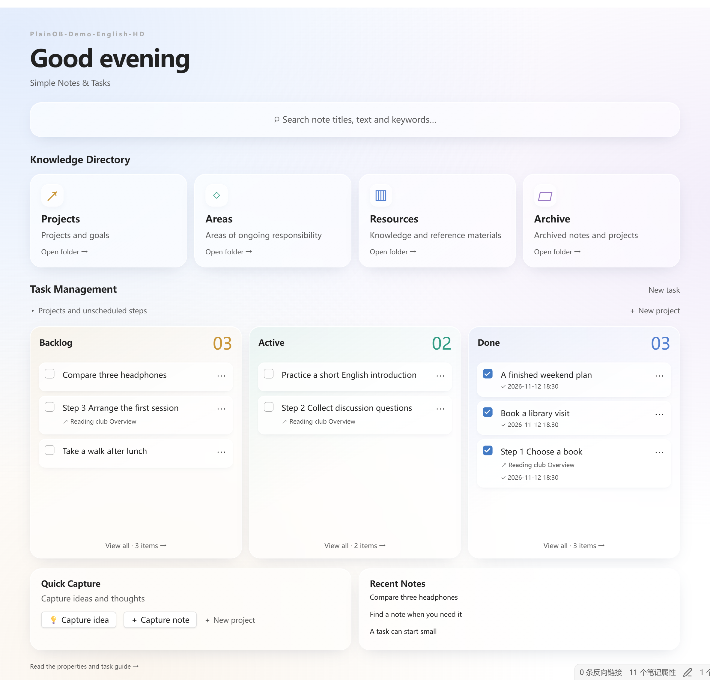
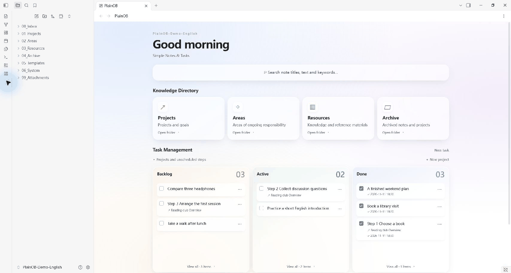
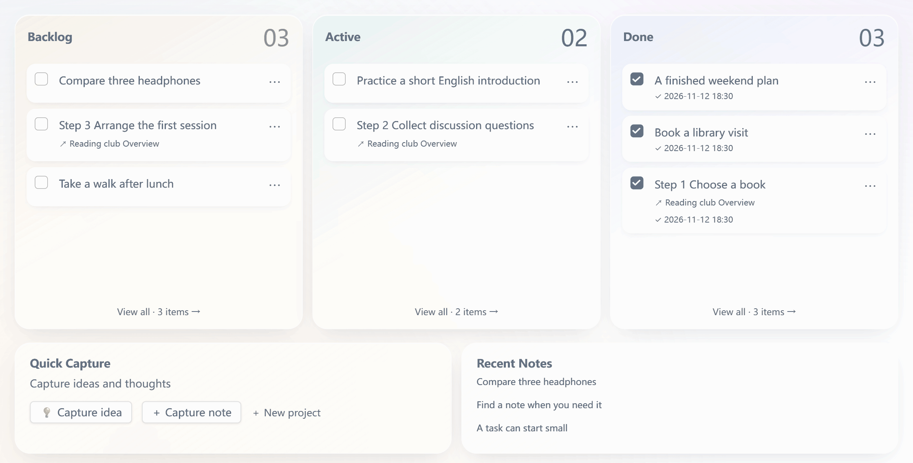
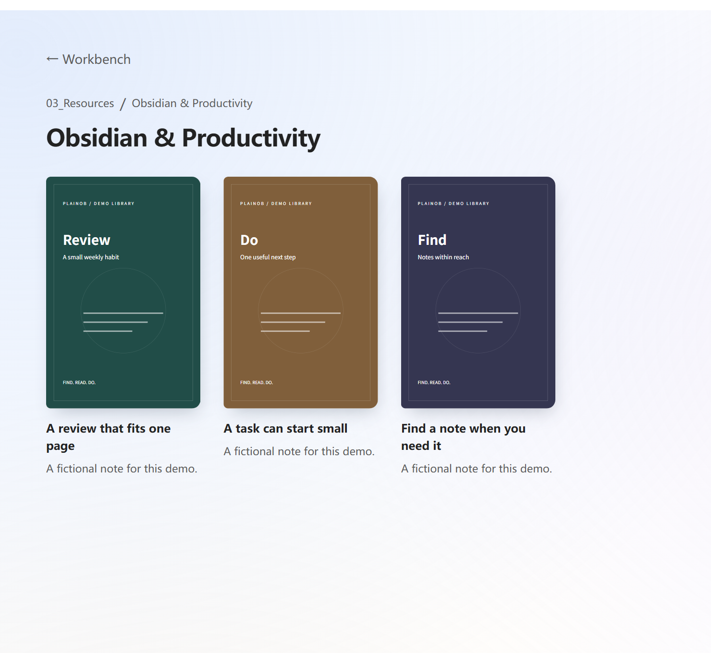
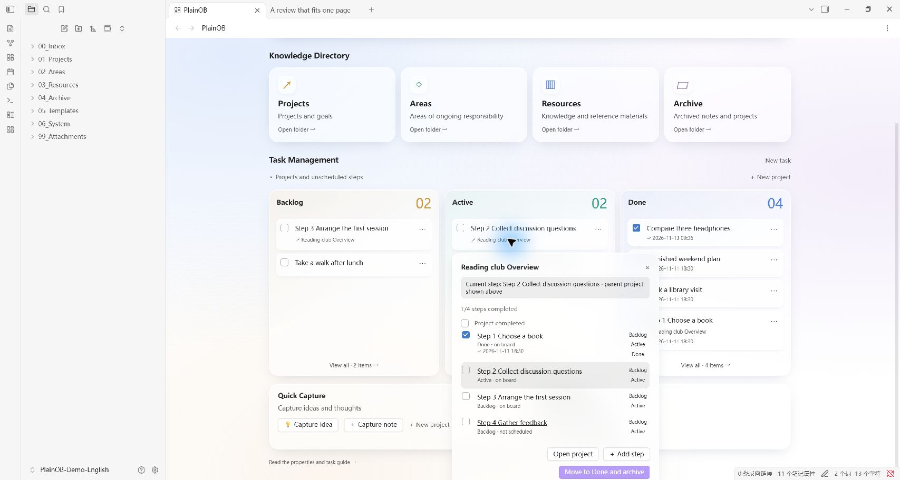

[English](README.md) / [简体中文](README.zh-CN.md) / [繁體中文](README.zh-TW.md) / [日本語](README.ja.md) / [한국어](README.ko.md)

<h1 align="center">PlainOB</h1>

<p align="center">
  <strong>Simple Notes &amp; Tasks</strong><br>
  為日常筆記、靈感與任務，準備一個簡單的 Obsidian 首頁。
</p>

<p align="center">
  
  
  <a href="LICENSE"></a>
</p>

<p align="center">
  <a href="https://github.com/GavinYanCQ/obsidian-plainob-dashboard/releases/download/1.4.2/PlainOB-1.4.2-installer.zip"><strong>⬇ 下載安裝包 · 1.4.2</strong></a>
  &nbsp;·&nbsp;
  <a href="CHANGELOG.md">查看更新記錄</a>
</p>

<p align="center">
  <a href="#-快速開始">快速開始</a> ·
  <a href="#-功能">功能介紹</a> ·
  <a href="docs/INSTALL.en.md">安裝指南（英文）</a> ·
  <a href="#-贊助與支持">贊助支持</a>
</p>

很多時候，我們太執著於折騰工具的過程，反而忘了使用工具的初衷。

我不想在打開 Obsidian 的第一眼，先面對滿版的桌布、月曆、時鐘與番茄鐘——這些功能系統裡早就有，堆在首頁上只會分散注意力。做 **PlainOB** 的想法很簡單，讓首頁回歸它該有的樣子，只解決三個核心需求：

1. **找得到**：用關鍵字直接搜尋筆記標題與內文。
2. **理得清**：內建四類知識目錄，點選就能前往對應分類的筆記。
3. **推得動**：一套極簡的任務看板，兼顧學習、生活與工作。支援獨立任務，也能將專案拆成連續步驟，隨時看清哪些待辦、哪些進行中、哪些已完成。



## 🚀 快速開始

1. **安裝外掛：**解壓縮安裝包，將 `plainob` 資料夾放入筆記庫的 `.obsidian/plugins/`，並在 Obsidian 中啟用。
2. **完成設定精靈：**選擇建立新系統或對應現有資料夾，設定介面語言，預覽後套用。
3. **開始記錄：**記下一個靈感、建立筆記，或勾選筆記的 task 屬性，讓任務卡片在待辦、進行中與已完成之間流轉。

適用於 **Windows 與 macOS 桌面版，Obsidian 1.15.0+**。目前為 **1.4.2**，採手動安裝，尚未上架社群外掛目錄。

→ [完整安裝、升級與第二台裝置設定指南（英文）](docs/INSTALL.en.md)

## ✨ 功能

1. **搜尋需要的筆記。**用關鍵字搜尋標題與內文，預覽標示符合字詞的句子，點選後跳回原文位置。
2. **快速進入知識目錄。**專案、領域、資源、封存四個入口，逐層瀏覽分類與筆記；書架可展示自訂封面。
3. **看清手上的任務。**學習、生活與工作中的獨立事項，以及專案中逐步推進的任務，都能分別安排至待辦、進行中與已完成。支援拖曳排序、完成時間、專案進度，以及封存後還原。

四步設定精靈協助你開始使用，可選簡體中文或英文介面、編號目錄或現有資料夾對應。範本、屬性下拉選單與 AI 整理規則都是選用輔助；工作台的重心始終是上面三件事。

專案首頁文件提供英文、簡體中文、繁體中文、日文與韓文版本。**外掛介面目前僅支援簡體中文與英文**；切換文件語言不會改變外掛介面。詳細安裝指南目前提供[英文](docs/INSTALL.en.md)與[簡體中文](docs/INSTALL.zh-CN.md)。

## 👀 看看實際操作

下列畫面來自真實 Obsidian 桌面版中的虛構示範筆記庫，PlainOB 介面與示範筆記使用英文。Obsidian 本身的控制項依主程式語言顯示。動圖由操作的關鍵畫面組成，並非連續錄影。

**搜尋內文並跳至符合的句子：**



**透過卡片選單將任務移至進行中，勾選完成後再放入已完成：**



<details>
<summary>查看書架與獨立專案步驟</summary>





</details>

## 🧭 日常怎麼使用

| 想做什麼 | 在 PlainOB 中怎麼做 |
| --- | --- |
| 隨手記下一個想法 | 快速記錄靈感，存入 Inbox/Ideas |
| 整理筆記位置 | 為 Inbox 中的筆記選擇分類 |
| 把筆記變成待處理事項 | 勾選 task 屬性 |
| 分步驟推進專案 | 分別安排、拖曳各步驟卡片 |
| 找回筆記中的一句話 | 搜尋關鍵字，點選符合的句子跳回原文 |
| 在另一台裝置使用 | 自行傳輸筆記內容，再匯入自己的移轉設定 |

## 相容性與安裝

目前為 **1.4.2**，適用於 **Windows、macOS 桌面版的 Obsidian 1.15.0 以上版本**，暫不支援手機與平板。兩個系統使用同一份外掛檔案，不含固定磁碟機代號或個人目錄。

目前採手動安裝，尚未提交至 Obsidian 社群外掛目錄。詳見[安裝與升級說明（英文）](docs/INSTALL.en.md)。

下載包提供程式碼與說明，不含個人筆記庫、已儲存設定、帳號金鑰、筆記或同步設定。首次啟用會開啟設定精靈；只有預覽並套用後，才會建立資料夾與選定的基礎範本。首頁稱呼預設為空白，可自行填寫。

## 現有筆記與另一台裝置

「使用現有資料夾」是將工作台角色對應至既有資料夾，例如讓 Inbox 對應「草稿箱」、Projects 對應「工作」。設定精靈保留現有檔案，不會大量搬動或改寫舊筆記。日常使用時，任務自動化作用於已勾選 task 的筆記，分類自動化則作用於你已選擇分類的 Inbox 筆記。

在另一台裝置上使用時，先以自行選擇的方式複製或同步內容，再安裝 PlainOB，並匯入從自己原裝置匯出的移轉設定。設定檔含自訂資料夾名稱、稱呼與規則，分享前請先檢查；它不會傳輸筆記，也不會安裝其他外掛。同步服務可自行選用，獨立於 PlainOB。

## 選用外掛與隱私

核心工作台不依賴 Metadata Menu、Claudian、BRAT 或同步外掛。Metadata Menu 提供屬性下拉選單，目前設定精靈只自動適配 0.8.12。AI 工具與帳號需另外設定。PlainOB 不會下載、安裝或啟用這些外掛。

PlainOB 本身不發送網路請求，也不包含使用統計追蹤。選用的 AI 規則可能產生官方影片嵌入播放器，開啟該筆記時會連線至對應影片平台；第三方 AI 與同步外掛遵循各自設定與政策。詳見[隱私與相依工具說明（英文／簡體中文）](docs/PRIVACY.md)。

## 開發與驗證

需要 Python 3 與 Node.js 22 LTS 以上版本，不需安裝額外套件。

```sh
python work/build_workbench.py
node --test work/workbench/*.test.js
python work/package_public.py
```

請安裝建置後的 main.js。79 項本機自動檢查通過。使用者已回報 Windows 端 1.4.2 的搜尋、任務拖曳、完成後恢復及專案歸檔測試正常，Mac 端從 1.4.0 升級後使用正常。這不代表新版所有首次安裝情境皆已逐項驗收。證據與待完成的社群審核見[發布清單](docs/RELEASE-CHECKLIST.md)。

## 💖 贊助與支持

如果 PlainOB 對你的日常記錄有幫助，歡迎透過以下任一方式支持後續維護。謝謝你支持這個開源專案。

<table>
  <thead>
    <tr>
      <th align="center">Ko-fi <em>中國大陸以外地區</em></th>
      <th></th>
      <th align="center">微信支付 <em>中國大陸地區</em></th>
    </tr>
  </thead>
  <tbody>
    <tr>
      <td align="center" valign="middle"><a href="https://ko-fi.com/gavinyancq"></a></td>
      <td align="center" valign="middle">或</td>
      <td align="center" valign="middle"><a href="docs/images/wechat-pay.png"></a><br><sub>使用微信掃碼支持 · 點選查看原圖</sub></td>
    </tr>
  </tbody>
</table>

也歡迎透過為儲存庫加星號、回報問題、改進翻譯或完善文件來支持專案。參與方式見[貢獻說明（英文）](CONTRIBUTING.md)。

## 授權條款

MIT 授權條款 · 作者 GavinCQ · [LICENSE](LICENSE)。
